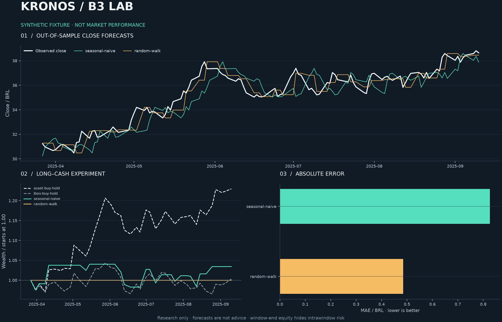
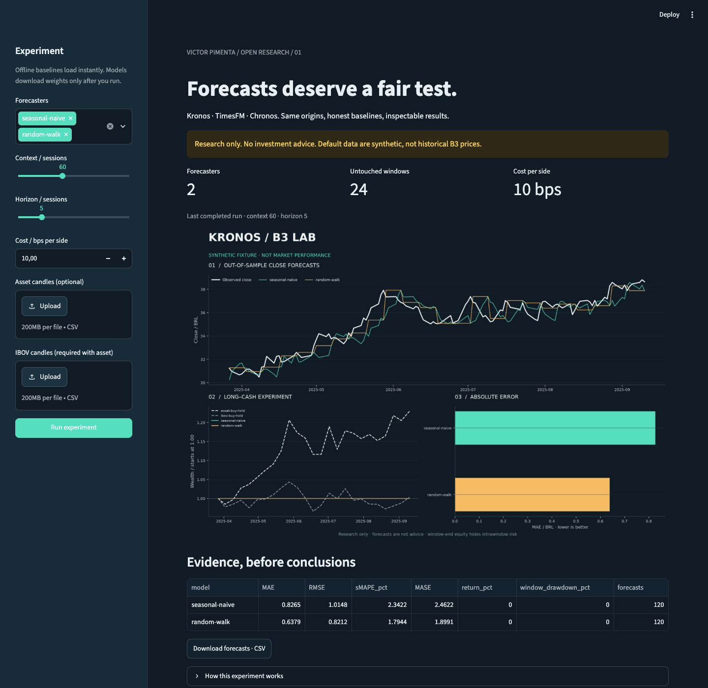

# Kronos / B3 Lab

**Zero-shot forecasts. Baselines that get a fair fight.**

[](https://github.com/VictorPimentaDev/kronos-b3-lab/actions/workflows/ci.yml)
[](pyproject.toml)
[](LICENSE)
[](#try-it)

A small research bench for **Kronos, TimesFM and Chronos on Brazilian candles**.
One rolling-origin protocol, two transparent baselines, a next-open paper experiment
and exportable evidence. No broker connection. No promises of alpha.



*This image uses fictional fixtures and seasonal-naive/random-walk baselines.
It is not a chart of B3 history or a foundation model's performance.*

> **Research only. Not investment advice.** A forecast is not a recommendation,
> a reliable trading signal or a guarantee. You can lose money. This repository
> does not execute orders, assess suitability or model the full cost of trading.

## Try it

From a checkout, with Python 3.11+:

```sh
python -m pip install -e '.[app]'
b3-lab run --horizon 3
streamlit run app.py
```

No API key, model download or market-data connection is needed for this demo.
The command creates `runs/demo/report.png`, `predictions.csv`, `metrics.csv`,
`equity.csv` and a versioned, input-hashed `manifest.json`. `python -m kronos_b3_lab`
is equivalent to `b3-lab`. Outputs in the chosen folder are replaced on each run;
use a fresh `--out` folder for each experiment you want to retain.

The Streamlit app lets you compare forecasters, change context/horizon/costs,
upload an explicit asset/IBOV CSV pair, inspect metrics and download predictions.


Optional models load only when selected and run. Failed dependencies fail visibly;
there is no silent fallback to a baseline.

## What is actually here

| Component | Behavior |
|---|---|
| Kronos-small | OHLCV + calendar adapter; optional upstream checkout and weights |
| TimesFM 2.5 / 200M | Univariate close adapter; optional PyPI extra and weights |
| Chronos T5 tiny | Univariate sampled close forecasts; optional PyPI extra and weights |
| Baselines | Seasonal-naive (period 5) and random walk (last close) |
| Evaluation | Disjoint rolling origins; fixed-size history, untouched future windows |
| Evidence | MAE, RMSE, sMAPE, MASE, paper return and window-end drawdown |
| Interfaces | CLI, Streamlit, CSV/JSON exports and headless matplotlib |

[Install and run the real models →](docs/models.md) · [Real-weight smoke guide →](docs/model-smoke.md) · [Verification evidence →](docs/verification/README.md)

## Bring B3 candles

```sh
pip install -e '.[data]'
b3-lab fetch WEGE3.SA --start 2024-01-01 --end 2025-01-01 --out data/wege.csv
b3-lab fetch '^BVSP' --start 2024-01-01 --end 2025-01-01 --out data/ibov.csv
b3-lab run --asset data/wege.csv --ibov data/ibov.csv --horizon 3 --out runs/wege
```

The [yfinance adapter](https://ranaroussi.github.io/yfinance/reference/api/yfinance.download.html)
downloads adjusted daily OHLCV, writes retrieval time and settings to a JSON sidecar,
and fails if prices are empty or invalid. Respect Yahoo's data terms; redistribution
rights are separate from this code's MIT license. No live data are checked in.

CSV columns: `date,open,high,low,close,volume`. Dates are daily, timezone-free,
unique and increasing. Asset and IBOV dates must match exactly; missing prices,
duplicate sessions, invalid OHLC ranges and nonfinite values are rejected. Align
inputs explicitly, document any removed sessions and never forward-fill prices to
make a backtest pass. The fetch end date is exclusive.

## Read the experiment correctly

At each origin, the model sees exactly `context` previous sessions. The next
`horizon` session dates are public calendar inputs, but future OHLCV never reaches
the predictor. Windows advance by the horizon, so test targets do not overlap.
An incomplete last window is excluded. No normalization or model fitting uses
held-out prices. All models share the same context, origins and targets.

A terminal forecast above the last known close enters a fully invested long at the
**next open**; otherwise it holds zero-yield cash. The position exits at the last
close of that window. Each window is a separate round trip, even for consecutive
long signals. With cost fraction `c`, its wealth multiplier is
`exit_close * (1-c) / (entry_open * (1+c))`. The default 10 bps **per side** is an
illustrative all-in assumption, not a current B3 fee schedule. No leverage or shorts.

Buy-and-hold asset and IBOV comparators start at the same first open, end on the
same last close, and pay the same entry/exit cost assumption. The IBOV line is a
hypothetical index comparison, **not an executable instrument**. Window points
show liquidation wealth; they omit intrawindow drawdown. There is no Sharpe claim.

Forecast errors pool all target steps: MAE/RMSE are in price units; sMAPE is a
percentage. MASE divides each error by the mean one-step absolute change in that
origin's training window (random-walk scale); zero denominators are undefined and
omitted from the mean. If every denominator is zero, MASE is blank/NaN. MASE does
not use the held-out series as its scaling denominator.

**A useful sanity check:** random walk always stays in cash under the strict
positive-return rule. At horizons divisible by five, seasonal-naive's terminal
forecast also equals the last known close and stays in cash. The screenshot uses
a three-session horizon so that behavior is visible. It was not selected for
better returns.

## Limits worth keeping in view

- Fixtures are [explicitly synthetic](src/kronos_b3_lab/fixtures/README.md), including
  their weekday calendar. They verify software, not predictive skill.
- Foundation-model pretraining may overlap your test dates. Rolling-origin
  evaluation prevents local lookahead; it cannot prove pretraining was leak-free.
- Adjusted vendor history can be revised. Corporate actions, survivorship bias,
  dividends, halts, liquidity, slippage beyond the cost assumption, taxes and
  settlement are not independently reconstructed. No point-in-time data guarantee.
- There is no parameter search, significance test or claim of outperforming IBOV.
  Tuning after viewing these windows makes them development data. Reserve a new
  chronological holdout before making research claims.
- CI uses model test doubles; optional weights and dependencies have their own
  licenses, memory requirements and version compatibility. See the model guide.

## Development

```sh
pip install -e '.[dev,app]'
ruff check .
ruff format --check .
pytest -q
python -m build
```

Tests cover causal boundaries, future-price perturbation, next-open execution,
fees, bad candles, baseline behavior, provider contracts, CLI exports and Streamlit
reruns. CI runs offline on Python 3.11 and 3.12 and uploads the generated report.
See [CONTRIBUTING](CONTRIBUTING.md) for focused ways to help.

## Em português

Um laboratório para testar modelos de séries temporais na B3 com regras claras:
mesmas janelas, baselines simples e evidências exportáveis. O demo roda offline com
dados fictícios. Os modelos reais são opcionais e os resultados sintéticos não
provam vantagem no mercado. **Não é recomendação de investimento.**

Código original por Victor Pimenta, licença MIT. Kronos, TimesFM e Chronos são
projetos independentes; este repositório não tem afiliação com seus autores.
